<p align="center">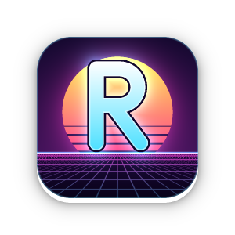</p>

# Retroy

**A game store for the TrimUI Brick Pro.** Browse a catalog on your handheld, press a button, and new games land on your SD card. No computer needed after the first setup.

<p align="center">
  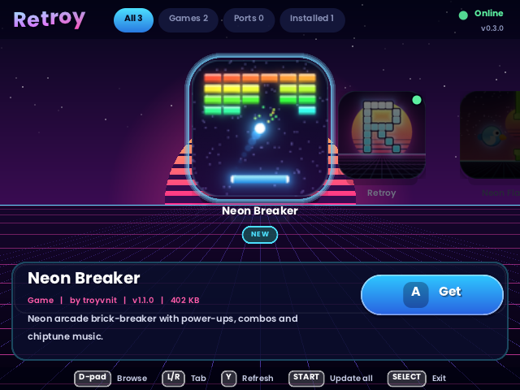
</p>

## What you get

- **One-button installs.** Pick a game, press **A**. Retroy downloads it, checks it is intact, and installs it.
- **Play straight from the store.** When an install finishes, press **A** again to launch the game right away, or open it later with the green **PLAY** button.
- **Updates and removal.** Items show **NEW**, **INSTALLED** or **UPDATE**. Remove anything with **X**.
- **Games and Ports.** Original games built for the Brick Pro today; more games and community Ports are planned.
- **Safe by design.** Every download is verified with a SHA-256 checksum and rejected if it does not match. Packages can only install into `Apps/` or `Ports/`, and the installer refuses any file that tries to write anywhere else.
- **Works offline for browsing.** The last catalog is cached, so you can still look around without Wi-Fi.

> **Status: early release (0.1.x).** Built for the **TrimUI Brick Pro** with its stock firmware. It was developed and tested on a computer and has had limited testing on real hardware, so please [report problems](../../issues) (see [Feedback](#feedback)).

## Games

### Neon Breaker
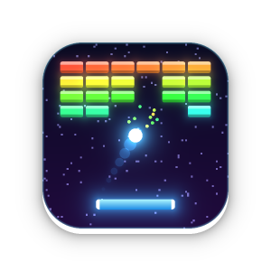

A neon arcade brick-breaker made for the Brick Pro: power-ups, a combo multiplier, fireball and laser, 8 level layouts that repeat harder, a self-playing demo on the title screen, chiptune music, and a saved high score.

<p align="center">
  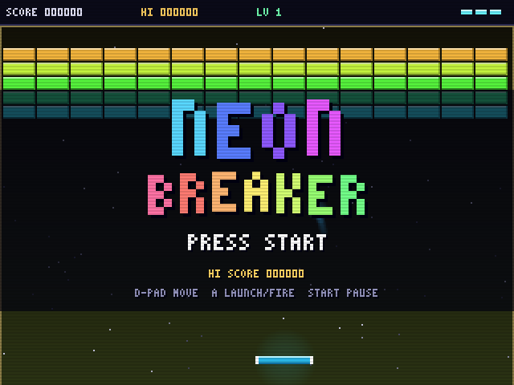
  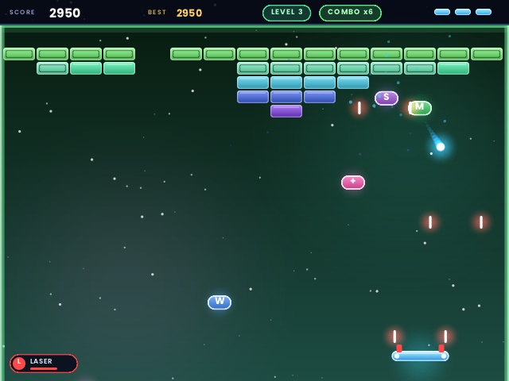
  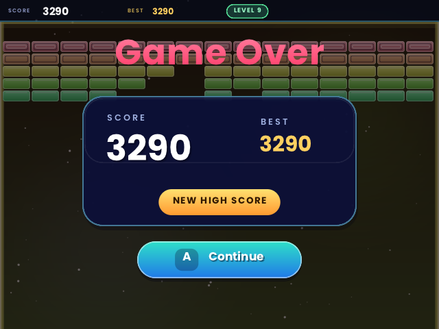
</p>

| Button | Action |
|---|---|
| D-pad / left stick | Move the paddle |
| A / B / X / Y | Launch the ball, fire the laser |
| START | Pause |
| SELECT | Music on / off |

Power-ups: **W** wide paddle, **M** multi-ball, **S** slow motion, **L** laser, **F** fireball, **+** extra life.

### Neon Flap
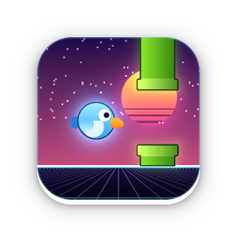

One button, one neon bird, endless pipes. Tap to flap, thread the gaps, and chase the medals. Smooth, high-resolution graphics with soft glows and a clean modern interface. The world shifts colour every 10 points, the gaps tighten as you improve, and the title screen plays itself so you can watch a run before you start.

<p align="center">
  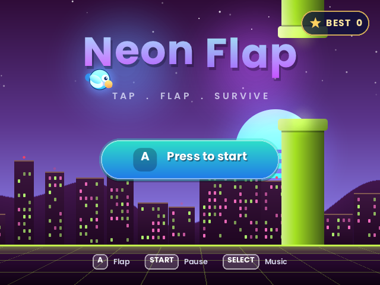
  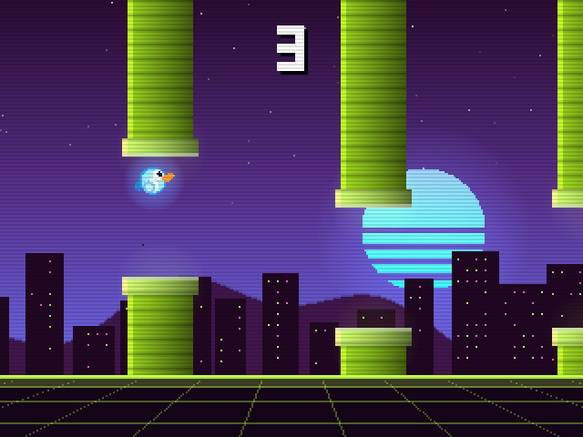
  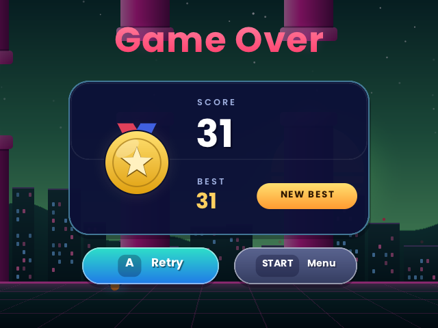
</p>

| Button | Action |
|---|---|
| A / B / X / Y / Up | Flap |
| START | Pause |
| SELECT | Music on / off |

Medals: **10** bronze, **20** silver, **30** gold, **40** platinum. Your best score is saved.

### Prism
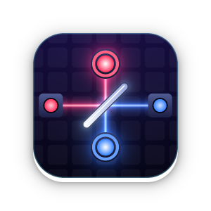

Bend the light, light them all. Rotate mirrors and splitters so the coloured beams reach every target; where two beams cross, a two-colour target needs both. Levels never run out and each one is checked by a solver, so every puzzle can be solved, and it tells you the par. Match par for three stars. New pieces arrive gradually, and the title screen solves puzzles by itself while you watch.

<p align="center">
  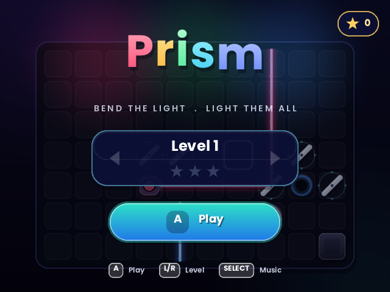
  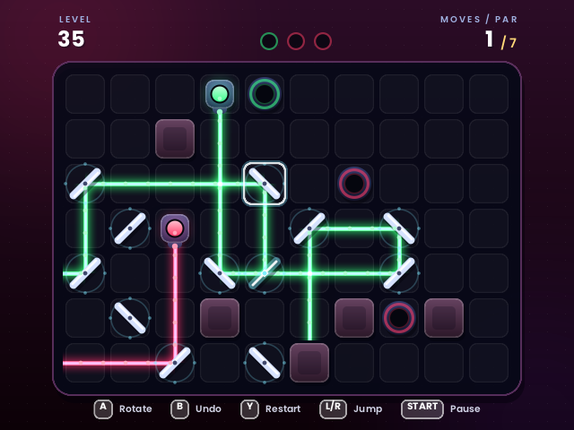
  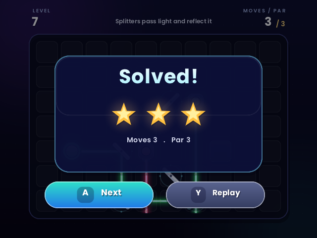
</p>

| Button | Action |
|---|---|
| D-pad | Move the cursor |
| A | Rotate the piece |
| B | Undo |
| Y | Restart the level |
| L / R | Jump to the previous / next piece |
| START | Pause |
| SELECT | Music on / off |

Your unlocked level and the stars for every level are saved. Pick any unlocked level on the title screen with L / R.

### Word Smash
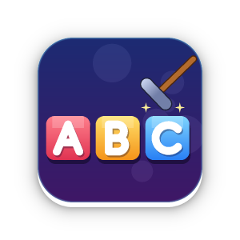

English vocabulary for kids, made for IOE (Internet Olympiad of English) practice. Every word comes with a picture. Smash the letter that does not belong, fill in the missing letter, unscramble the letters, pick the right picture, or spell the whole word on the keyboard. **IOE mix** mixes every kind of question in one round. Words your kid misses come back later in the round and more often next time, and each pack shows how many words are learned.

<p align="center">
  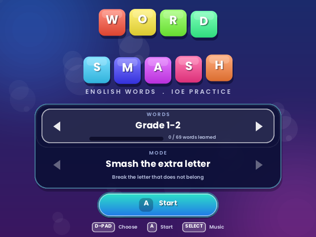
  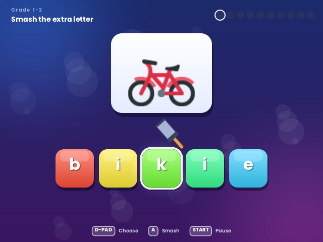
  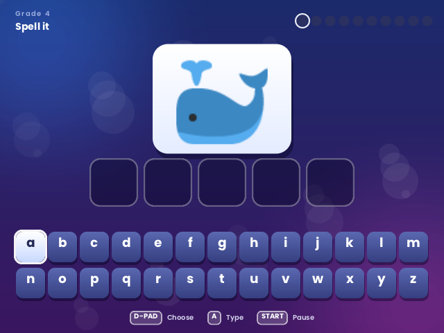
</p>

- **Word packs:** Grade 1-2, Grade 3, Grade 4 and Grade 5 (232 picture words: animals, food, school, family, jobs, clothes, weather, places, transport, sports, actions, feelings...).
- **Your own words:** copy `Ports/WordSmash/words-example.txt` to `words.txt` and add one word per line, with an optional clue after `=` (Vietnamese works, e.g. `friend = bạn bè`). A **My words** pack appears on the title screen. Game updates never overwrite `words.txt`.

| Button | Action |
|---|---|
| D-pad | Choose a letter, picture or key |
| A | Smash / place / type |
| START | Pause (B in the pause menu returns to the title) |
| SELECT | Music on / off |

Pictures: [Twemoji](https://github.com/jdecked/twemoji) (CC-BY 4.0). Clue font: Be Vietnam Pro (SIL OFL).

## Install Retroy (one-time setup)

You need a computer that can read your SD card, and a Brick Pro that can join Wi-Fi.

1. **Download the latest `retroy-x.y.z.zip`** from the [Releases page](../../releases) (look for the release named *Retroy*). Current version: [retroy-0.3.1.zip](https://github.com/troyvnit/retroy-releases/releases/download/retroy-0.3.1/retroy-0.3.1.zip).
2. **Turn the Brick Pro off** and put its SD card in your computer.
3. **Unzip onto the root of the SD card** (the folder that already contains `Apps`, `Roms`, `Emus`, `RetroArch`, ...). Accept merging folders. You should end up with:
   ```
   SD card
   └── Apps
       └── Retroy
           ├── bin/            (bundled downloader and certificates)
           ├── retroy_libretro.so
           ├── launch.sh
           └── ...
   ```
4. **Eject the card safely**, put it back in the handheld and power on.
5. **Connect the Brick Pro to Wi-Fi** in its system settings and make sure the **date and time are correct** (secure downloads fail if the clock is wrong).
6. Open **Apps → Retroy**.

The top right of the Retroy screen should say **ONLINE** and list the available games.

## Install a game

1. In Retroy, browse the carousel with the **D-pad** (switch tabs with **L / R**). Each card shows the game's icon; the bar at the bottom shows its description and a button: **GET** (not installed), **UPDATE**, or **PLAY**.
2. Press **A** on a game you want. A progress bar shows the download and install.
3. When it says **INSTALLED**, press **A** to **play it right now**, or **B** to stay in the store.
4. Installed games also appear in the handheld's main menu under **Ports** (apps under **Apps**), and from Retroy you can start them any time: open the game and press **A** on the green **PLAY** button. When you quit the game you return to the main menu.

<p align="center">
  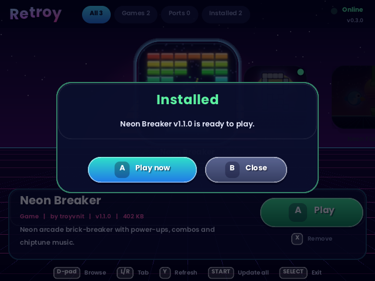
  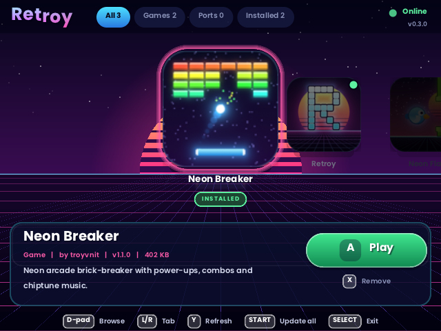
</p>

## Controls in Retroy

| Button | Action |
|---|---|
| D-pad | Browse the carousel |
| L / R | Switch tab: All, Games, Ports, Installed |
| **A** | **GET** / **UPDATE** the selected item, or **PLAY** it when it is installed |
| **X** | Remove the selected item (asks to confirm) |
| **Y** | Refresh the catalog |
| **START** | Update everything that has an update |
| **B** | Cancel a download / close a message |
| **SELECT** | Exit Retroy |

## Updating (OTA)

- Retroy checks for updates every time it opens. If a newer **Retroy** is available it offers to update itself: press **A**, wait for the download, and it restarts into the new version on its own.
- Items with an **UPDATE** badge have a newer version. Press **A** on one, or press **START** to update everything at once (Retroy itself goes last, then restarts).
- Press **Y** at any time to check again.

## Troubleshooting

| What you see | What to do |
|---|---|
| **OFFLINE** / *NO CATALOG* | The handheld has no connection. Connect to Wi-Fi, then press **Y**. |
| *TLS / CERTIFICATE ERROR* or `curl: (35) Send failure: Broken pipe` | Either the date/time is wrong, or your network is cutting the connection to GitHub. Retroy automatically retries through a mirror (jsDelivr) and remembers what works. If both fail, try another Wi-Fi network or a phone hotspot. |
| *certificate ... not yet valid* (or similar) | The handheld's date or time is wrong. Set it correctly in system settings. |
| **DOWNLOAD FAILED** | Check Wi-Fi and try again. The message under it is the downloader's own error. |
| **NO DOWNLOADER** | `Apps/Retroy/bin/curl` is missing. Re-extract the Retroy zip onto the card. |
| **CHECKSUM MISMATCH** | The file was damaged or altered and was rejected. Try again; if it keeps happening, please report it. |
| **NOT ENOUGH SPACE** | Free some room on the SD card. |
| Installed game is not in the menu | Return to the main menu or restart the handheld. Games install into `Ports/`. |

When Retroy cannot reach its servers it shows a network check under the message, e.g. `raw.githubusercontent.com: DNS FAIL` (name lookup blocked), `TCP FAIL` (connection blocked) or `TCP OK` (the network is fine; the problem is later). Tell us which one you see.

To see exactly what happened, put the SD card in a computer and open `Apps/Retroy/data/retroy.log` (each attempt: address reached, result, error). Attach it when you [report a problem](../../issues).

## Settings

Advanced users can edit `Apps/Retroy/retroy.cfg`:

```ini
catalog_url=https://raw.githubusercontent.com/troyvnit/retroy-releases/main/catalog.json
root=/mnt/SDCARD
```

## Uninstall

Remove games from inside Retroy with **X**. To remove Retroy itself, delete the `Apps/Retroy` folder from the SD card.

## Feedback

Found a bug, or want a game or Port added? [Open an issue](../../issues). Please include what the screen said and the device firmware version.

---

*This repository only hosts the public catalog (`catalog.json`) and the downloadable packages (Releases). Retroy is an independent project and is not affiliated with TrimUI.*
